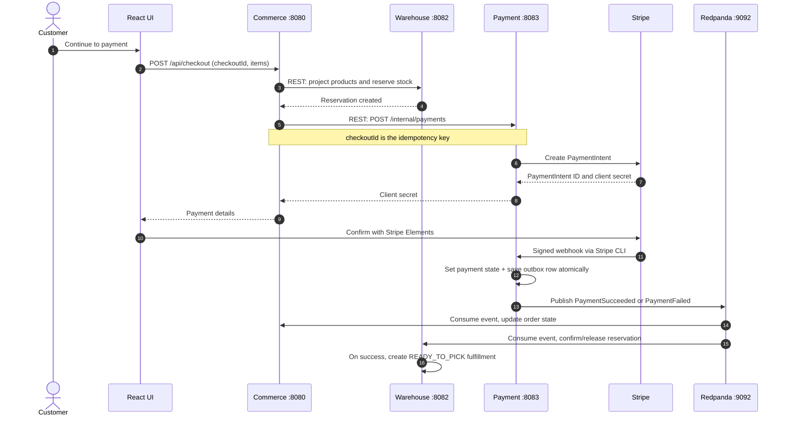

# Stripe Payment Process Flow



## Important behavior

- Commerce calculates the amount from its own catalog; the browser never supplies the amount.
- Payment owns Stripe API keys, PaymentIntent records, webhook verification, and the outbox.
- Stripe's webhook is the source of truth for final payment status.
- The payment outbox makes the database update and the intent to publish an event atomic. Publishing is at-least-once, so both Commerce and Warehouse store processed event IDs to ignore duplicates.
- Repeating checkout with the same `(userId, checkoutId)` reuses the Commerce order and the existing Stripe PaymentIntent. Warehouse additionally deduplicates by `commerceOrderId`, and Payment has unique keys for both `checkoutId` and `commerceOrderId`.
- Commerce sends `X-Internal-Api-Key` to the Warehouse and Payment `/internal/**` APIs. This shared credential is loaded from `INTERNAL_API_KEY`; it should come from a secret manager outside local development.

## Inventory reservation concurrency and checkout expiry

Warehouse locks each affected `inventory_levels` row with a pessimistic write lock before it checks
availability or increments `reserved_quantity`. For multi-SKU carts it locks product IDs in sorted
order, then rechecks whether another retry already created the reservation. This prevents two
concurrent checkouts from both reserving the same available stock.

Commerce, rather than Warehouse, owns the 15-minute checkout expiry decision. This is necessary
because Warehouse cannot know whether a customer submitted payment to Stripe moments before the
timer fired.

```text
Expired PENDING_PAYMENT order
  -> Commerce asks Payment to retrieve the Stripe PaymentIntent
  -> requires_payment_method / requires_action: Payment cancels at Stripe
     -> Commerce releases the Warehouse reservation and marks the order CANCELED
  -> processing: preserve reservation and wait for final Stripe outcome
  -> succeeded: Payment reconciles to PAID and emits PaymentSucceeded
```

Inventory is never released merely because a local timer elapsed. It is released only after Stripe
confirms a terminal non-success result.

## Outbox failure handling

Kafka publication is outside the database transaction that records each event's delivery result.
This deliberately allows the unavoidable at-least-once case—Kafka accepts a message and the
process dies before `published_at` is committed—because duplicate delivery is safer than an event
being lost. Consumers deduplicate with their processed-event inbox tables.

Each failed event is handled independently, so a poison payload or temporary broker outage does
not block later events in the batch:

```text
Kafka send fails
  -> increment retry_count and save last_error
  -> wait for exponential next_attempt_at (2s, 4s, ... capped at 60s)
  -> after OUTBOX_MAX_ATTEMPTS (default 5), copy to dead-letter table and stop normal retries
```

Monitor unpublished non-dead-letter rows older than five minutes and dead-letter insertions.

## Missed-webhook reconciliation

The Payment service also runs a scheduled reconciliation job. Every minute by default, it retrieves
nonterminal PaymentIntents older than a 60-second grace period from Stripe and compares their
authoritative Stripe status with the local `payments` row.

```text
Local payment = CREATED, Stripe PaymentIntent = succeeded
  -> reconciliation marks payment PAID
  -> writes the same PaymentSucceeded outbox event as the webhook path
  -> Kafka updates Commerce and Warehouse
```

`requires_payment_method` and `requires_action` are not failures: the customer may not have
submitted payment yet. They remain open until the checkout-expiration workflow cancels the intent
and releases the warehouse reservation. Configure the job with
`PAYMENT_RECONCILIATION_DELAY_MS` and `PAYMENT_RECONCILIATION_GRACE_PERIOD_SECONDS`.

## Return and refund lifecycle

```text
Customer requests return in Commerce
  -> return_requests + return_items created (APPROVED)
  -> demo RMA and prepaid-label reference returned to customer
  -> Warehouse inspects the package
  -> SELLABLE items: on-hand inventory increases; RETURN_RECEIPT movement is written
  -> Warehouse outbox publishes ReturnInspected to warehouse-events
  -> Commerce consumes ReturnInspected and calls Payment with (orderId, returnId)
  -> Payment creates/refetches the provider refund using returnId as its idempotency key
  -> payment_refunds is stored as PENDING; the original payment remains PAID
  -> Stripe sends a signed refund.updated webhook
  -> Payment marks the refund SUCCEEDED or FAILED and writes a RefundSucceeded/RefundFailed outbox event
  -> Commerce consumes that event and marks the return/order REFUNDED only on success
```

The synchronous Stripe Refund API response only acknowledges the request. The signed
`refund.updated` webhook determines the final refund state. Payment records the Stripe webhook
event ID in its inbox table before returning `200`, so retries cannot produce duplicate events.

Warehouse never calls Stripe. It publishes the physical-inspection fact; Commerce owns the
business decision to request the refund, and Payment owns the provider interaction.

## Local webhook forwarding

```bash
stripe listen --forward-to localhost:8083/api/stripe/webhook
```

Place the signing secret printed by Stripe CLI only in Payment's ignored local configuration. The public `application.yml` reads it from `STRIPE_WEBHOOK_SECRET` in non-local environments.
